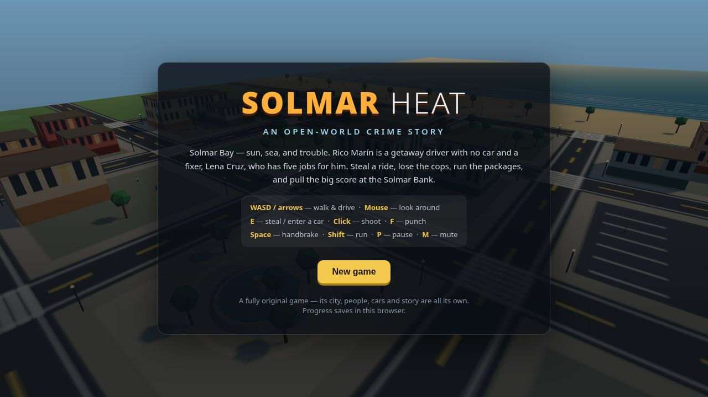
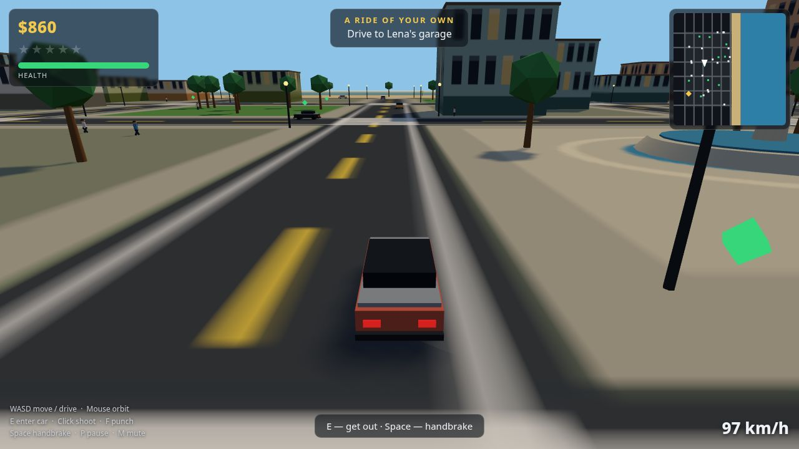
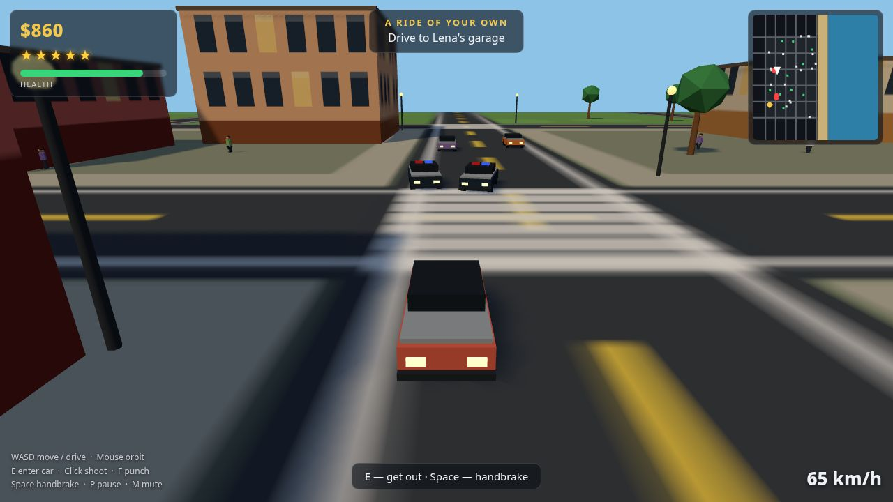
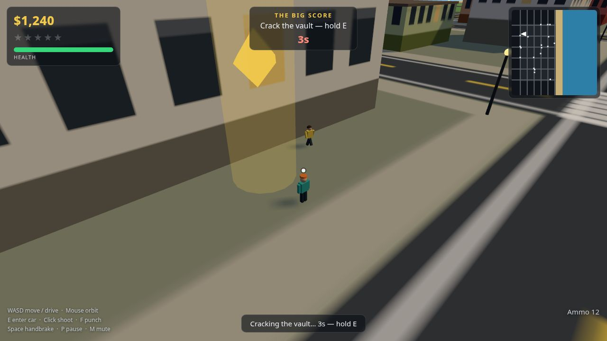

[](https://make.fun/bounty/gta6-01)
[](https://make.fun/bounty/gta6-01)
[](https://make.fun/bounty/gta6-01)

# Solmar Heat

**Solmar Heat** is an original 3D open-world crime game set in Solmar Bay, a
fictional coastal city of sun, sea, and trouble. You play Rico Marín, a getaway
driver who starts with no car and a reputation to rebuild. Lena Cruz, a fixer
who runs a garage in the south-west of the city, has five jobs for him — and
each one pulls him deeper into the heat.

Everything in the game is its own: the city, the people, the cars, and the
story were all made for this game. There are no borrowed names, logos, or
assets from any other game or film.

## The city

Solmar Bay is a 5-by-5 grid of city blocks with wide roads, sidewalks, and
crosswalks, and a beach with palm trees and umbrellas running down its eastern
edge into the sea. Traffic cars drive the roads and stop behind each other,
pedestrians walk the sidewalks and scatter when trouble starts, and the whole
city is open from the moment you step out — no locked districts, no loading
screens between streets.

You explore on foot or behind the wheel. Walk up to any parked or passing car
and press **E** to take it; the driver gets out and the car is yours. Drive
fast, cut corners, and use the handbrake to slide through turns — but every
crime is noticed. Stealing a car, speeding past a patrol, or firing a shot
raises your wanted level, shown as up to five stars, and the police answer
with patrol cars that chase and ram you and officers on foot who will bust you
if they catch you. Lose the heat by breaking line of sight and staying out of
trouble until the stars fade.

## Story and missions

Lena's five jobs pay from $150 to $800 and build into one arc: steal a first
ride for the garage, run a package from the docks to the Marina hotel against
the clock, lift a fast red Comet from the plaza while the cops are watching,
drive a five-checkpoint getaway with the police already on your tail, and
finish with the big score — cracking the vault at the Solmar Bank, dealing
with its guards, and escaping to the safehouse. Each mission shows its current
objective and timer at the top of the screen, and finishing one pays out in
cash you can see in the HUD.

Between jobs the city is yours to roam: pick up fares, find faster cars, or
just cruise the beach road and watch the sun hit the sea.

## Combat and the HUD

On foot you carry a pistol and your fists. Click to shoot, **F** to punch, and
keep an eye on the ammo count — the pistol holds twelve rounds. Your health
regenerates slowly once you are out of danger. The HUD keeps everything in
view: cash, wanted stars, and a health bar at the top left; the active mission
and its objective across the top; a live minimap at the top right showing the
streets, your position, and your target; and your speed and ammo at the bottom
right when you are driving or armed.

## How to run it

Solmar Heat is plain static files and runs fully offline in a desktop browser
— no install, no account, no network request. It needs a keyboard and a mouse.

**Option 1 — open the file directly:**

```text
Open game/index.html in your desktop browser.
```

**Option 2 — serve it locally (Node 22):**

```bash
node serve.ts
# then open http://localhost:8080
```

The title screen offers **New game** or **Continue** if a save exists. Press
**P** any time to pause, save, restart, or mute. Progress — missions
completed, cash, and your best score — is saved in your browser's local
storage, so you can close the tab and pick up where you left off.

## Features

- A full open-world city to explore on foot and by car: 25 blocks, a beach,
  and the sea, all in one continuous map
- Driving with acceleration, braking, reversing, steering that tightens at
  speed, and a handbrake for sliding turns
- Living streets: traffic that follows the roads and pedestrians who walk the
  sidewalks and flee from danger
- Car theft: take any car you can reach, including a special fast car guarded
  by a wanted level of its own
- A five-star wanted system with police patrol cars that chase and ram and
  officers on foot who can bust you
- Five story missions with timed deliveries, checkpoints, a vault crack, and a
  final escape, paying $150–$800 each
- Combat on foot: a 12-round pistol and a punch, with health that recovers
  out of danger
- A complete HUD: cash, wanted stars, health, mission objective and timer,
  speed, ammo, and a live minimap
- Start screen, pause menu, and a save that persists in the browser
- Procedural sound with no audio files: an engine hum that follows your
  speed, a two-tone police siren, gunshots, pickups, and music — mute with **M**

## Controls

| Input | What it does |
| --- | --- |
| WASD / arrow keys | Walk and drive (W forward, S brake / reverse, A and D steer) |
| Mouse | Orbit the camera around Rico |
| E | Steal or enter a car, pick up a package, hold to crack the vault |
| Click | Shoot the pistol |
| F | Punch |
| Space | Handbrake |
| Shift | Run on foot |
| P or Esc | Pause (resume, save, restart, mute) |
| M | Mute / unmute all sound |

## The five missions

| # | Mission | The job | Reward |
| --- | --- | --- | --- |
| 1 | A Ride of Your Own | Steal any car and bring it to Lena's garage | $150 |
| 2 | The Pickup | Collect a package at the docks and deliver it to the Marina hotel in 95 seconds | $250 |
| 3 | Hot Wheels | Steal the fast red Comet from the plaza, lose the heat, then deliver it to the garage | $400 |
| 4 | The Getaway | Hit five checkpoints across the city in 160 seconds with the police already chasing you | $500 |
| 5 | The Big Score | Reach the Solmar Bank, crack the vault, deal with three guards, and escape to the safehouse | $800 |

Missions unlock in order. Failing one — busted or wasted — sends you back to
the streets to try again; the city itself never locks you out.

## Screenshots






## How it is built

The game is plain static files: `game/index.html` plus ES modules under
`game/src/`, with Three.js vendored locally under `game/vendor/`, so nothing
is fetched from the internet at runtime. The city, traffic, pedestrians,
police, missions, and sound are all generated in code — the ground texture is
drawn procedurally, the soundtrack and effects are synthesized live with
WebAudio, and there are no downloaded models, textures, or audio files. The
optional Node tooling (`main.ts`, `serve.ts`) only copies the game and its
screenshots into an output folder and serves them; it is not part of the game
itself.

Solmar Heat was built for the [gta6-01 bounty on make.fun](https://make.fun/bounty/gta6-01) —
an open-world crime game in the spirit of GTA 6, made entirely from scratch.
